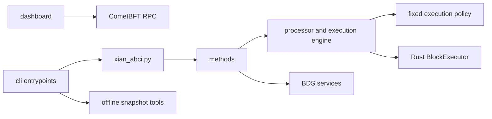

# xian

## Purpose

This package contains the main Xian node runtime and the backend-oriented
subsystems around it.

## Contents

- `xian_abci.py`: runtime assembly, startup wiring, and ABCI request dispatch
- `methods/`: request handlers for `CheckTx`, `FinalizeBlock`, query, proposal
  validation, and related ABCI methods
- `processor.py`, `execution_engine.py`, and `execution_policy.py`: block
  processing in the Rust `BlockExecutor` (receipts and their log records), the
  native runtime startup checks and call context, and the execution policy
- `simulator.py` (readonly simulations, in-process on the Rust
  `xian_vm_core.execute_tx`), `metrics.py`, and `vm_observability.py`:
  simulation and observability helpers
- `services/`: BDS and offline application snapshot tools
- `cli/`: backend entrypoints owned by this repo
- `dashboard/`: optional HTTP dashboard surface
- `node_defaults.py`: shared application defaults and the CometBFT template
  for runtime loading, setup options and the CLI; BDS defaults live in `services/bds/config.py`
- `node_setup.py` and `node_admin.py`: node-home creation and configuration
  helpers
- `genesis_builder.py` and `state_export.py`: genesis, export, and restore
  helpers
- `utils/` and `tools/`: shared helpers plus transition-area data such as state
  patches and genesis-upgrade assets

## Notes

- This is the main architectural boundary in the repo. Changes here often
  affect node behavior directly.
- `methods/`, execution flow, rewards, validators, and state export/import are
  especially consensus-sensitive.

## Next

- Open `xian_abci.py` and `methods/` for transaction and request flow.
- Open `services/` for BDS and offline application snapshot work.
- Open `dashboard/` for the optional HTTP dashboard surface.
- Open `cli/` when changing backend-oriented commands exposed by this repo.
